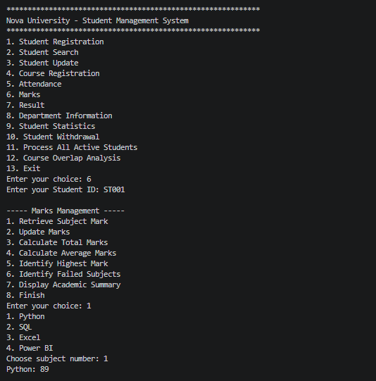
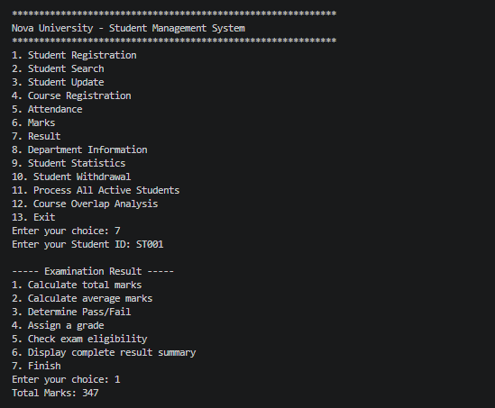

# Nova University – Student Management & Academic Service System

## 1. Application Overview

**Nova University – Student Management & Academic Service System** is a console-based Python application developed for managing student registration and basic academic services.

The application allows administration staff to:

- Register and search students.
- Update student information.
- Manage course registrations.
- Store and update marks.
- Manage attendance and examination eligibility.
- Calculate academic results.
- View department information.
- Generate student statistics.
- Process academic summaries for active students.
- Analyse course overlap using set operations.
- Withdraw students while preserving their records.

The application runs in the Python terminal and does not require a GUI, web application, or database.

---

## 2. Problem Statement

Nova University needs a single system to replace several manual student-service activities. The system must store student details, prevent duplicate Student IDs, manage departments and courses, maintain academic marks and attendance, generate examination results, support student searches and updates, and exclude withdrawn students from active academic processing.

This project solves the problem using Python variables, dictionaries, lists, sets, functions, conditions, loops, validation, and built-in methods.

---

## 3. Main Features

### Student Registration

- Registers a new student.
- Stores Student ID, name, department, year, email, phone number, attendance, marks, academic status, courses, and active/withdrawn status.
- Rejects empty Student IDs and duplicate Student IDs.
- Validates year, marks, attendance, and phone number.

### Student Search

- Searches for a student using Student ID.
- Displays the complete student record when found.
- Displays an appropriate message when the Student ID does not exist.

### Student Update

- Updates name, department, year, email, phone number, and academic status.
- Prevents updates to withdrawn students.
- Allows the updated student record to be displayed.

### Course Registration

- Adds courses for a student.
- Uses a set to prevent duplicate course registration.
- Displays registered courses.
- Allows a registered course to be withdrawn.
- Prevents course registration for withdrawn students.

### Attendance Management

- Stores attendance between 0% and 100%.
- Displays attendance.
- Updates attendance.
- Checks examination eligibility.
- A student with attendance of **75% or above** is eligible.

### Marks Management

- Stores marks for Python, SQL, Excel, and Power BI.
- Validates marks between 0 and 100.
- Retrieves marks for a selected subject.
- Updates marks.
- Calculates total and average marks.
- Identifies the highest-mark subject.
- Identifies failed subjects.
- Displays an academic summary.

### Examination Result

- Calculates total marks and average marks.
- Determines pass/fail status.
- Assigns a grade.
- Checks examination eligibility.
- Displays a complete result summary.

### Department Information

- Displays all available departments.
- Displays details of a selected department.
- Counts active students in a department.
- Displays active students in a department.
- Handles departments through predefined department codes.

### Student Statistics

- Calculates total active students.
- Displays department-wise student counts.
- Counts eligible students.
- Counts students who failed.
- Finds the highest and lowest average.
- Calculates batch average performance.
- Displays unique departments represented.
- Lists students registered for a selected course.
- Displays complete active-student statistics.

### Student Processing

- Generates an academic summary for every active student.
- Displays attendance, eligibility, marks, total, average, pass/fail result, and grade.
- Excludes withdrawn students from processing.

### Course Overlap Analysis

Uses set operations to identify:

- Students registered for both Python and SQL.
- Students registered for Python but not SQL.
- Students registered for at least one of the two courses.
- Students registered for exactly one of the two courses.
- Whether the two groups are completely different.

The function also accepts a manually entered list of Student IDs and checks whether duplicate IDs exist in that input.

### Student Withdrawal

- Searches for a student before withdrawal.
- Displays the student record for verification.
- Confirms the withdrawal.
- Changes the status to `Withdrawn`.
- Preserves the student information.
- Excludes withdrawn students from active academic processing, statistics, department counts, and course-overlap analysis.

---

## 4. Business Rules

1. Student IDs must be unique.
2. A Student ID cannot be empty.
3. A student name cannot be empty.
4. Department selection is restricted to the predefined departments.
5. Year must be between 1 and 4.
6. Phone number must contain exactly 10 digits.
7. Attendance must be between 0 and 100.
8. Marks must be between 0 and 100.
9. A student cannot register for the same course more than once.
10. A student with attendance of 75% or above is examination eligible.
11. A student passes only when every subject mark is at least 50.
12. Withdrawn students cannot register for courses, update details, manage attendance, or manage marks.
13. Withdrawn students are excluded from active academic processing.
14. Student records are preserved after withdrawal.

### Grade Scale

| Average Marks | Grade |
|---|---|
| 90–100 | A |
| 80–89 | B |
| 70–79 | C |
| 60–69 | D |
| 50–59 | E |
| Below 50 | F |

> **Implementation assumption:** The grade is calculated from the student's average mark, while pass/fail is determined by checking every subject mark.

---

## 5. Data Structures and Justification

| Requirement | Data Structure | Reason |
|---|---|---|
| Multiple students | Dictionary | Student ID can be used as a unique key for fast lookup and duplicate checking. |
| Unique Student IDs | Dictionary keys | Dictionary keys must be unique, so duplicate IDs are rejected. |
| Departments | Dictionary | Maps department codes to department names and supports validation and lookup. |
| Courses for a student | Set | Prevents duplicate course registration and supports membership checking. |
| Student marks | Dictionary | Maps each subject name to its mark. |
| Attendance | Float stored inside a dictionary | Represents percentage values such as 72.5 or 85.0. |
| Complete student record | Nested dictionary | Groups all student-related information in one structured record. |
| Course participation groups | Set | Supports intersection, difference, union, symmetric difference, and disjointness checks. |
| Subject order | List | `SUBJECTS` maintains a predictable order for mark input and display. |

---

## 6. Important Functions

| Function | Responsibility |
|---|---|
| `read_int()` | Reads and validates integer input with optional limits. |
| `read_float()` | Reads and validates decimal input with optional limits. |
| `read_phone()` | Validates a 10-digit phone number. |
| `choose_department()` | Displays departments and returns the selected department code. |
| `read_marks()` | Collects validated marks for all subjects. |
| `calculate_total()` | Calculates total marks. |
| `calculate_average()` | Calculates average marks. |
| `is_passed()` | Checks whether all subject marks meet the pass mark. |
| `calculate_grade()` | Assigns a grade based on average marks. |
| `is_active()` | Checks whether a student is active. |
| `student_reg()` | Registers a student and stores the complete record. |
| `display_student()` | Displays a student record. |
| `student_search()` | Searches for a student by ID. |
| `student_update()` | Updates editable student details. |
| `course_reg()` | Adds, displays, and withdraws courses. |
| `attendance()` | Retrieves, updates, and checks attendance eligibility. |
| `marks()` | Retrieves, updates, and summarizes marks. |
| `result()` | Displays examination result options and calculations. |
| `dept_info()` | Displays department information and active-student details. |
| `get_active_students()` | Returns only active student records. |
| `student_statistic()` | Generates active-student statistics. |
| `process_all_students()` | Processes and displays summaries for all active students. |
| `course_overlap_analysis()` | Compares Python and SQL registration groups using sets. |
| `student_withdrawal()` | Withdraws a student without deleting the record. |
| `display_menu()` | Displays the main menu and dispatches the selected service. |
| `main()` | Repeatedly runs the application menu. |

---

## 7. Console Interaction

1. Run the Python file.
2. The main menu is displayed.
3. Select a service by entering its menu number.
4. Complete the requested operation.
5. Return to the main menu and select another service.
6. Select **Exit** to terminate the application.

The application supports multiple operations in the same session through the loop in `main()` and the submenu loops used by the service functions.

### Main Menu

1. Student Registration
2. Student Search
3. Student Update
4. Course Registration
5. Attendance
6. Marks
7. Result
8. Department Information
9. Student Statistics
10. Student Withdrawal
11. Process All Active Students
12. Course Overlap Analysis
13. Exit

---

## 8. Project Structure

```text
Nova_Console_app/
├── main.py
├── README.md
└── Output/
    ├── Attendance Percentage.png
    ├── Course overlap.png
    ├── Course registration.png
    ├── Department Information.png
    ├── Marks.png
    ├── Processed active students.png
    ├── Result.png
    ├── Student registration.png
    ├── Student statistics.png
    ├── Student update.png
    ├── Student withdrawal.png
    └── View student.png
```

The `Output/` folder contains screenshots of the application's main features.

---

## 9. Application Screenshots

The `Output/` folder contains 12 screenshots demonstrating the application's main features. These are **relative paths from the repository root**. Keep the `Output` folder beside `main.py` and `README.md`, and make sure each filename and extension matches the uploaded image file. The links below assume `.png` extensions.

### Attendance Percentage


### Course Overlap


### Course Registration


### Department Information


### Marks


### Processed Active Students


### Result


### Student Registration


### Student Statistics


### Student Update


### Student Withdrawal


### View Student


## 10. How to Run

Make sure Python 3 is installed.

```bash
python main.py
```

Then follow the instructions displayed in the terminal.

---

## 11. Learning Outcomes

This project demonstrates practical use of:

- Variables and user input
- Conditional statements
- `while` and `for` loops
- Lists, dictionaries, and sets
- Functions and reusable logic
- Dictionary and set methods
- Input validation
- Searching and updating records
- Aggregation and calculation
- Set operations
- Console menu design
- Business-requirement-based data-structure selection
